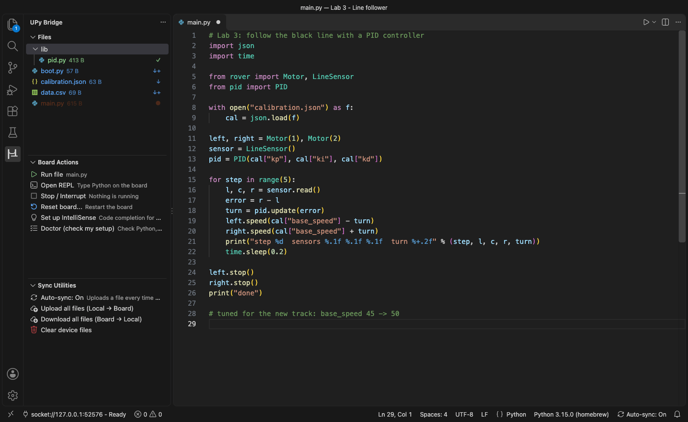
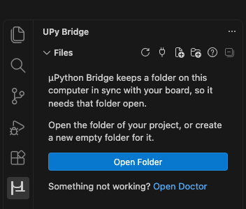
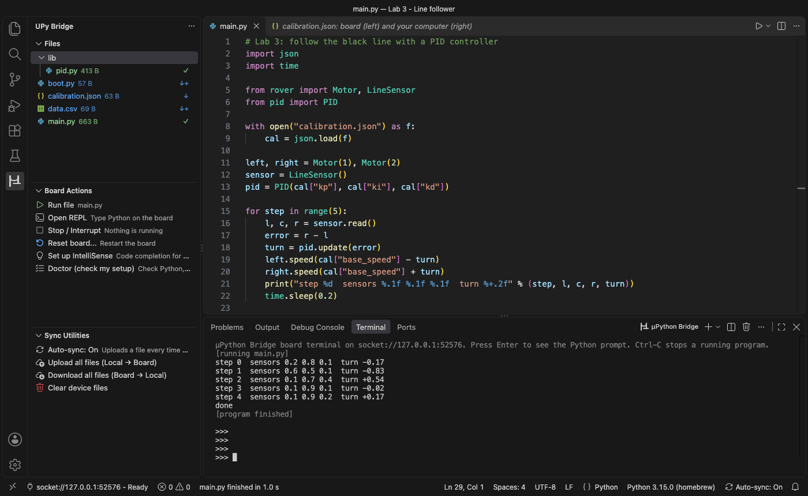
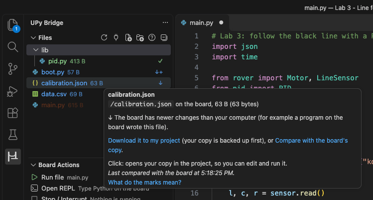
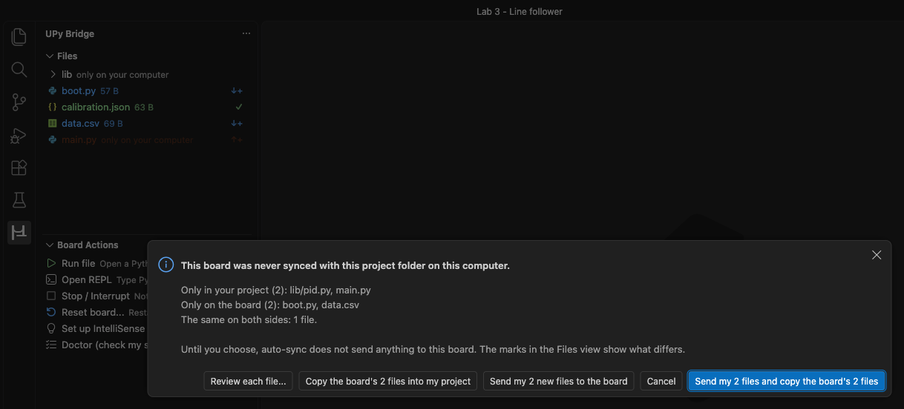
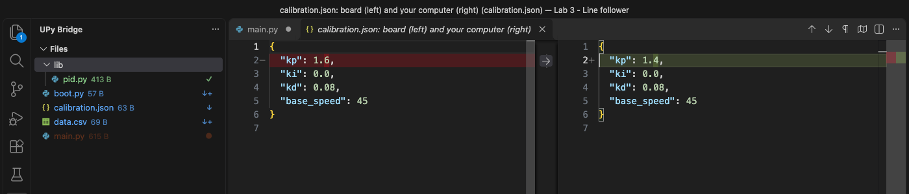
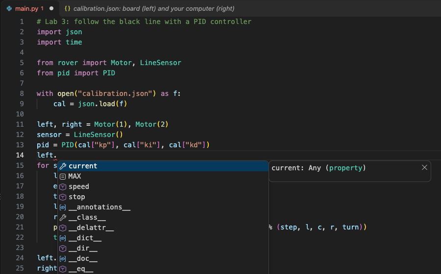
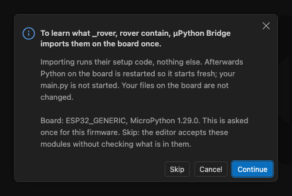

# μPython Bridge

**Run MicroPython programs on your board, keep your project folder and the board in sync, and get IntelliSense for
MicroPython and for your board's own firmware: all from VS Code.**

Made for people who are learning to program, on macOS and Windows. It works with stock MicroPython on ESP32, Raspberry Pi
Pico, STM32 and other boards, and with custom firmware.



- **Run the file you are editing** with one click. The output appears in a terminal tab, and keys you type there go to your
  program. **Stop** always works.
- **Your project folder is the source of truth.** Saving a file sends it to the board. A mark next to each file shows which
  side is newer, and **nothing newer is ever overwritten without asking**.
- **IntelliSense that knows your board.** Code completion and error checking for `machine`, `time.sleep_ms()` and the rest
  of MicroPython, and for the modules built into your board's firmware, learned from the board itself.
- **Safe with real hardware.** Connecting, listing files, uploading and auto-sync never reset the board. A reset happens only
  when you ask for one.
- **Nothing extra to install.** You need Python on your computer, and μPython Bridge finds it by itself. No `mpremote`, no
  `pip install`, no terminal commands.

> **Status: first pre-release (0.1.0).** It has been tested in VS Code on macOS with simulated boards, and its
> connection layer has been tested with a real ESP32. It has not been tried on Windows or by students yet. If something
> looks wrong, run **Doctor (check my setup)** and look at the log (see [Troubleshooting](#troubleshooting)).

## Getting started

1. **Open your project folder** (*File, Open Folder*), or create a new empty folder for a new project. μPython Bridge keeps
   this folder in sync with the board, so it needs a folder: until one is open, its views show only an **Open Folder**
   button.

   

2. **Plug in the board** and click the **μPython Bridge** icon in the activity bar, then **Select Serial Port**. If exactly
   one likely board is plugged in, it is used at once. Otherwise you pick it from a list.
3. **The first time a board meets this folder**, you see what differs and choose what to do (see
   [Keeping files in sync](#keeping-files-in-sync)).
4. **Open a `.py` file and click Run file** in Board Actions. **Stop / Interrupt** stops it.

## Running programs



- **Run file** saves your file, sends any library files that are waiting, restarts Python on the board, and runs the file
  you are looking at. It runs exactly what is in the editor, so there is no "did it upload?" step.
- Output streams into the **μPython Bridge** terminal tab while the program runs. **Keys you type there go to your
  program**, so programs that read the keyboard work. Error messages show your file's path on your computer and the line
  number.
- **Stop** sends Ctrl-C twice and works even when the program is busy. It never resets the board. If a program ignores it,
  the message offers **Reset board...**.
- When the program ends, the same tab is the board's Python prompt (the REPL). **Open REPL** opens it directly.
- When VS Code closes, a program still running on the board is stopped. Closing the terminal tab stops a program that Run
  started. Both can be turned off in the settings.

## Keeping files in sync

**Auto-sync is on by default: saving a file uploads it to the board.** Uploads go only from your computer to the board;
nothing is copied back by itself. Turn auto-sync off with the **Auto-sync** row in Sync utilities.

Every file in the Files view has a mark. Hover over a file to see what the mark means and what to do next:



| Mark | Meaning |
|---|---|
| ✓ | Synced: the same on the board and on your computer |
| ↑ | Your computer has newer changes that still need to go to the board |
| ↑+ | A new file on your computer, not on the board yet |
| ↓ | The board has newer changes (for example, a program on the board wrote this file) |
| ↓+ | Only on the board (for example, a data file your program created) |
| ! | Changed on both sides since the last sync |
| ≠ | Different on the two sides and never synced on this computer, so it is not known which one is newer |
| ● | Unsaved changes in the editor |
| … | Waiting to be sent (a program is running, or the board is not connected) |
| ✗ | The last upload did not work (hover to see why) |

"Newer" is decided by comparing file contents with what was last synced, never by file dates. A board without a set clock
stamps its files with the year 2000, and copying a file changes its date.

**Nothing newer is overwritten without asking:**

- **The first time a board meets this project folder on this computer** (a new board, a lab partner's board, another
  computer), you see what is only in your project, what is only on the board and what differs. Nothing is sent until you
  choose. If both sides are already the same, it does not ask.

  

- **Every upload checks that the board's copy is still the one that was last synced.** If a program, another computer or a lab
  partner changed it, your save is not sent. The file gets the **!** or **≠** mark, and you choose: compare, upload (the board's
  copy is backed up first) or download (your copy is backed up first).
- **Compare with the board's copy** (in the hover, or right-click a file) opens a side-by-side view: the board on the left,
  your computer on the right.

  

- After a program runs, files it created on the board are **offered** for download, never downloaded by themselves.
- Nothing on the board is ever deleted automatically. **New File** and **New Folder** in the Files view create the item in
  your project and on the board at the same time.
- Files that must not go to the board go into a `.mpyignore` file (same rules as `.gitignore`). Settings files, `.venv`,
  `typings` and similar folders are skipped by default.

**Sync utilities** also has **Upload all files**, **Download all files** and **Clear device files**. Each one shows you a
plan first and a result for every file afterwards.

## IntelliSense for MicroPython and your board

Out of the box, VS Code's Python checker (Pylance) knows only desktop Python. It underlines `import machine`,
`time.sleep_ms(...)` and your firmware's own modules as errors. **Set Up MicroPython IntelliSense...** (Board Actions, the
Command Palette, or the light bulb on an unresolved import) fixes that:



- **Standard MicroPython:** the matching stubs for your board's family are already inside the extension: ESP32, ESP8266,
  Raspberry Pi Pico (RP2), STM32, SAMD, nRF and i.MX RT. Nothing is downloaded.
- **Your board's own modules** (for example, a course firmware with its own frozen package and C module) are learned **from
  the board**:
  - The board lists its built-in and frozen modules (nothing is run for that).
  - `.py` files in the board's `/lib` are copied read-only into your project, so the editor sees the real code.
  - To learn what a built-in or compiled module contains, it has to be imported on the board, which runs its setup code.
    You are asked **once per firmware**:

    

    Afterwards Python on the board is restarted so it starts fresh. That restart does **not** start your `main.py`.
    **Skip** imports nothing: the modules still resolve, but the editor accepts anything in them.
- **Your own files always win.** A `.py` or `.pyi` file in your project with the same name as a board module is used instead.
- **You see everything first.** A preview lists every file that will be written, and nothing is written until you agree.
  The generated files live in `.upy-bridge/`, are never uploaded to the board, and
  **Remove μPython Bridge IntelliSense Files...** deletes exactly those files again.

MicroPython does not keep parameter names, so functions learned from the board accept any arguments. Misspelled names
are still flagged.

## Resetting the board

μPython Bridge resets the board only when you ask. **Reset board...** offers up to three levels:

| Level | What happens | Asks first? |
|---|---|---|
| **Restart Python** (soft reset) | A fresh Python session; `boot.py` and `main.py` run again. The chip keeps running. | No |
| **Reboot board** (software) | The whole board restarts, like pressing its reset button. | Yes |
| **Reset with the RTS/DTR line** | A hardware reset through the USB adapter. Offered only when it is likely to work with your adapter; the first use is checked and remembered. | Yes |

Boards that drive motors can twitch during a full reboot, so the two bigger levels always ask first. **Stop never turns into
a reset.**

## The board clock

A board without internet starts its clock in the year 2000, so the files and data logs it writes get wrong dates. After
connecting, μPython Bridge sets the board's clock from your computer when the board's clock is clearly not set, but only while
no program runs. **Set the Board Clock from This Computer** sets it on request.

## The Doctor

**Doctor (check my setup)** lists what it found, with what to do next for every problem:
- which Python is used, and why
- whether the board connection starts
- the port and the board
- files in your folder that would hide board modules (for example a `time.py`)
- the state of the IntelliSense files
- the older MPY Workbench extension, if it is installed

## How it's designed

For the curious, and for instructors deciding whether to trust it with a class:

```
VS Code ─ views, commands, editor, terminal tab (a view on the stream, never the port's owner)
   │  JSON messages, one per line
Python helper ("the bridge") ─ the ONLY thing that opens the serial port
   │  MicroPython raw REPL over USB serial (pyserial)
Board
```

- **One owner of the serial port.** A small Python helper, started by the extension, is the only thing that ever opens the
  port. Everything else asks it: the views, Run, sync, the REPL and IntelliSense. Requests go through one queue, so a file
  upload can never interleave with a running program. The terminal tab only shows what the helper streams, so closing it
  cannot leave the port in a strange state.
- **It talks to the board the way MicroPython's own tool does.** The connection code follows `mpremote` (raw REPL, raw paste,
  the same control-line sequences) and ships `pyserial` inside the extension. It needs nothing installed besides Python
  (tested on 3.12 to 3.15; 3.9 to 3.11 usually work) and never runs commands through a shell.
- **Run sends the editor's text.** Run does not run "whatever is on the board". It sends the text in your editor through the
  raw REPL, compiled under your file's real path, so error messages point at your file. The file does not have to be on the
  board first, and it is not imported as a module.
- **Sync compares contents, not dates.** The board computes a SHA-256 of each file (a board that cannot is compared by
  downloading). A per-file baseline, remembered for each
  combination of project folder, board (by its unique ID) and computer, says what was last synced. That is how μPython Bridge
  tells "you changed it" from "the board changed it".
- **Uploads are compare-and-swap, and atomic.** Each upload says which version of the board's file it expects to replace. If
  the board's copy changed in the meantime, nothing is written. Data is written to a temporary file on the board and then
  renamed, so an unplugged cable cannot leave half a file behind. When you choose to replace a newer copy, it is backed up
  first.
- **No resets you did not ask for.** Connecting, listing, uploading and auto-sync never reset the board, and Stop is always
  Ctrl-C. Run restarts Python (a soft reset) before each run so that every run starts clean; you can turn that off.
- **Firmware-agnostic.** Nothing in the extension is specific to one board or course. What it knows about your board comes
  from the board.
- **Private.** No telemetry, no accounts, and nothing is downloaded while it runs. Everything it needs is inside the
  extension.

## Requirements

- VS Code 1.90 or newer on macOS or Windows, in a normal local window. Remote, WSL, SSH and Codespaces windows are not
  supported, because the board is plugged into your own computer.
- Python on your computer: 3.12 or newer is recommended, and 3.9 to 3.11 usually work. μPython Bridge looks for a `.venv` in
  your folder, the Python extension's choice, and the system Python. If you install Python on Windows, tick "Add python.exe
  to PATH".
- A board running MicroPython, and a USB cable that carries data (some cables only charge).
- For IntelliSense: the Python extension (it brings Pylance).

## Settings

| Setting | Meaning |
|---|---|
| `upy-bridge.autoSync` | `on` (default), `off`, or `ask`: upload a file when you save it |
| `upy-bridge.board.setClockOnConnect` | `whenUnset` (default), `always` or `off`: set the board clock from this computer after connecting |
| `upy-bridge.sync.debounceMs` | how long to wait after the last save before uploading (default 400) |
| `upy-bridge.rootPath` | the folder on the board that matches your project folder (default `/`) |
| `upy-bridge.pythonPath` | the full path of the Python to use; leave it empty to find one automatically |
| `upy-bridge.port` | a port to use, for example `COM3` or `/dev/cu.usbserial-0001`; leave it empty to choose from a list |
| `upy-bridge.run.freshStart` | restart Python on the board before each run (default on) |
| `upy-bridge.reset.showUnverifiedHardReset` | show the RTS/DTR reset even when it is not known to work |
| `upy-bridge.stopOnDisconnect` | interrupt the running program when the connection closes (default on) |
| `upy-bridge.stopOnTerminalClose` | stop the program started by Run when you close its terminal tab (default on) |
| `upy-bridge.intellisenseStubs` | `auto` (default), `off`, or a board family such as `esp32` or `rp2` to use when no board is connected |
| `upy-bridge.intellisenseOffer` | offer the IntelliSense setup after the first connection (default on) |
| `upy-bridge.logLevel` | `info` (default), or `debug` when you are asked to send a log |

In an untrusted folder (Restricted Mode), the folder's Python path and port settings are ignored, and nothing starts until
you trust the folder.

## Troubleshooting

1. **"Python was not found", or the Files view asks you to open the Doctor.** Install Python from python.org (on Windows,
   tick "Add python.exe to PATH") or create a `.venv` in your folder, then choose **Open Doctor**. The Doctor says which
   Python was tried and why it was not used. If Python is somewhere unusual, put its full path in `upy-bridge.pythonPath`.
2. **The port is "In use", or connecting fails with "busy".** Another program has the port open. Close Thonny, the Arduino
   or PlatformIO serial monitor, any other VS Code window, and any `mpremote` in a terminal, then choose **Retry**.
   Unplugging the board and plugging it back in also frees the port.
3. **No serial ports are listed.** Use a USB cable that carries data, or try another USB port. On Windows, install the
   driver for your board's USB chip (CP210x and CH340 are the common ones), then choose **Refresh list**.
4. **The board was unplugged, or its port changed** (Windows COM numbers can change). The status bar says *Unplugged*. Plug
   the board back in, and μPython Bridge tries to reconnect for about half a minute. If it does not, click the status bar
   item and choose the board again.
5. **A program will not stop, or nothing happens when you press Run.** Press **Stop** once more. If the board still does not
   answer, use **Reset board...**. Then open the log (*μPython Bridge: Show Log* in the Command Palette) and the Doctor: the
   log names the cause of every failure. Copy it into your question when you ask for help.

Also worth knowing:
- A file named like a board module (`time.py`, `machine.py`, `json.py`) is not uploaded, because it would hide the real
  module on the board. Rename it.
- Files in OneDrive or iCloud that are "online only" must be set to *Always keep on this device* before they can be
  uploaded.

## Installing from GitHub

Until it is on the Marketplace: download `upython-bridge-<version>.vsix` from the
[Releases page](https://github.com/jpswensen/upython-bridge/releases). In VS Code, open the Command Palette (Ctrl+Shift+P, or
Cmd+Shift+P on a Mac), choose **Extensions: Install from VSIX...**, and pick the downloaded file. To update, install a newer
file the same way.

## Building from source

You need [Node.js](https://nodejs.org) 20 or newer, and Python 3.9 or newer to run the bridge's own tests.

```
git clone https://github.com/jpswensen/upython-bridge.git
cd upython-bridge
npm ci
npm run package     # writes out/upython-bridge-<version>.vsix
```

`npm run verify` runs the type check, the unit tests and the package checks (about 30 seconds).
[DEVELOPING.md](DEVELOPING.md) explains the code, the test suites (including the Python bridge tests and the tests in a real
VS Code window) and how the screenshots are made. Problems and ideas are welcome as
[GitHub issues](https://github.com/jpswensen/upython-bridge/issues).

## Credits and licence

μPython Bridge is MIT-licensed. It includes these projects, under their own licences (see `NOTICE` and
`THIRD_PARTY_NOTICES`):
- [pyserial](https://github.com/pyserial/pyserial) (BSD-3-Clause)
- [mpremote](https://github.com/micropython/micropython/tree/master/tools/mpremote) from the MicroPython project (MIT)
- the [micropython-stubs](https://github.com/josverl/micropython-stubs) by Jos Verlinde (MIT)
- [typeshed](https://github.com/python/typeshed) (Apache-2.0 / MIT)

The sidebar layout and command set come from [MPY Workbench](https://github.com/DanielBustillos/mpy-workbench) by Juan Daniel
Bustillos Camargo (MIT), which μPython Bridge is designed to replace.

The screenshots show a simulated board. With a real board, the status bar shows its port, for example `COM3` or
`/dev/cu.usbserial-0001`.
